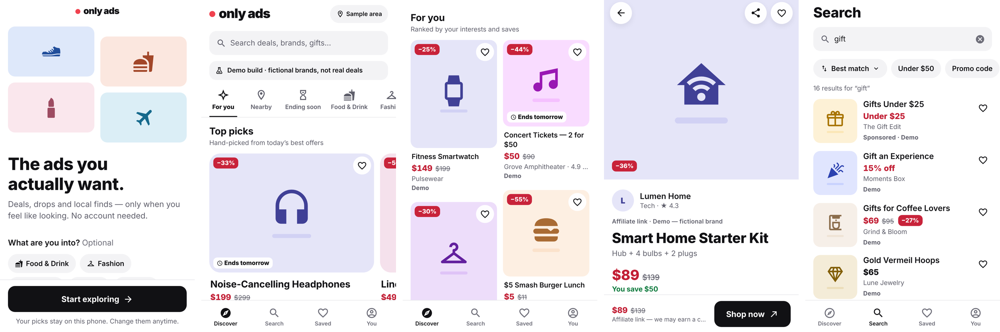
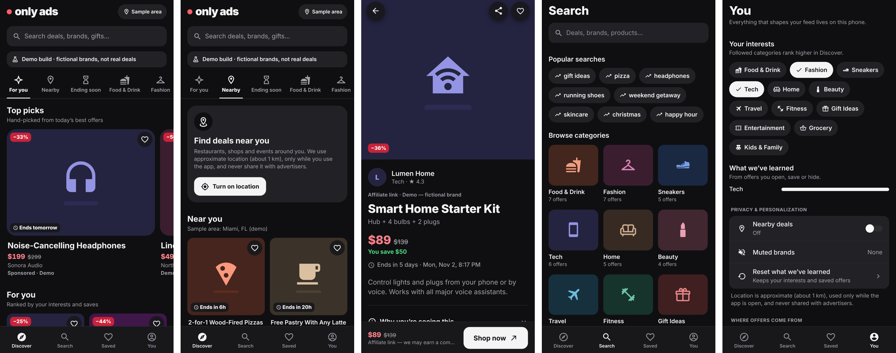

# Only Ads — Design System & UX

## Identity
- **The ads are the color.** The UI is a calm neutral canvas (white / near-black), so every offer stands out.
- **One signature accent, "Only Coral".** It's used for the brand dot, saved hearts, sale prices and the discount badge. Nothing else is coral.
- **Ink for actions.** Primary buttons and selected states use near-black ink (light mode) or near-white (dark mode), in the Apple/Airbnb style.
- **Wordmark:** lowercase heavy "only ads" with the coral dot.
- **No decorative gradients, glass, or emoji in the UI.** Placeholder ad art is a single soft tint of the brand color with the product glyph "standing" on a floor shadow, like a studio product shot. Real feed images replace it when they load, and it comes back if an image fails.

## Tokens (`src/theme/tokens.ts`)
| Token | Values |
|---|---|
| Colors | Semantic palette for light **and** dark: `canvas, surface, fill, line, text, textSecondary, textTertiary, ink, onInk, accent, accentText, sale, success, warning, danger` (+ soft tints). Every text pair is AA-tested in `design.test.ts`. |
| Type | Platform font (SF Pro / Roboto). `display 34 · title1 28 · title2 22 · title3 19 · headline 16 · body 16 · callout 15 · subhead 14 · footnote 13 · caption 12 · overline 11 · price 16 (tabular)` |
| Spacing | 4-pt scale: `2, 4, 8, 12, 16, 20, 24, 32, 48`. Screen inset 16, grid gutter 12. |
| Radii | Three only: `8` (badges), `14` (cards, inputs, buttons), `22` (hero media, sheets), plus pill for chips. |
| Elevation | Only for floating elements (overlay buttons, toasts, sheets). Cards are flat. |
| Icons | MaterialCommunityIcons outline set, at sizes 16 / 20 / 24 / 32. Platform glyphs for back and share (`platformIcons`). |
| Motion | 120 / 200 / 320 ms. Press scale 0.97. All motion is disabled or simplified under Reduce Motion. |

Styles are written with `makeStyles((t) => …)`. They are created once per color scheme and cached, so there are no inline magic colors.

## Components (`src/ui`, `src/components/offers`)
- **Primitives:** Text (type scale + tone), Icon, PressableScale, Button (primary / secondary / ghost / accent / destructive), IconButton, Chip (selected = fill **and** check icon, never color alone), SearchTrigger / SearchInput, Badge, Skeleton / FeedSkeleton, StateView (empty / error / permission), Banner, SectionHeader, ListGroup / ListRow (native Switch), OptionSheet (iOS action sheet, Android bottom sheet), Toast, LargeHeader / NavBar.
- **Offer card** (`OfferCard`) has four formats sharing one hierarchy: **media → verified discount → name → price (was) → advertiser → Sponsored/Demo**. The whole card is the tap target.
  - `grid` (masonry): the aspect ratio depends on the format. Products are portrait 4:5, places square, services landscape.
  - `hero` (Top picks), `compact` (rails), `row` (search results and Saved, price-forward for comparing).
- **Badge rules** (unit-tested in `presentation.ts`): a discount badge only when computed from a real price that's lower than a real previous price (≥ 5%). Urgency only when a real expiry is within 48h. Never "SALE" / "LIMITED" from free text.

## Information architecture
`Discover · Search · Saved · You` (4 tabs, down from 5).
- **Discover:** header with wordmark and location pill → search → discovery bar (For you · Nearby · Ending soon · 12 categories) that **filters in place** → Top picks carousel → masonry "For you". Woven-in modules: an Ending soon rail, a "Make it yours" interest picker for new users, and a location explainer.
- **Search:** recent searches, popular searches and a visual category grid. Results appear as you type, with sort (native sheet) and quick filters (Under $50, Promo code, Nearby).
- **Offer detail:** full-bleed media, floating back/share/save buttons, and a header that fades to solid with the brand name on scroll. Then the disclosure line, price with "You save", expiry, a copyable promo code, a place card with directions, a collapsible "Why you're seeing this" (Not interested / Mute brand / Report), and similar offers. A sticky CTA bar includes the affiliate notice.
- **Onboarding:** one screen with optional interests and **no** permission prompts. Location is requested in context, after an explanation, from Nearby or the feed.

## States (every one has an explanation + next action)
Loading skeleton (matches the masonry layout), first-time "Make it yours", no search results (Clear filters / Browse categories), empty Saved (Discover offers), offline banner with last-updated time + Retry, partial failure banner, full network error (Try again), failed image (placeholder art), expired offer (banner + similar offers + disabled CTA), unavailable offer (Back to Discover), location not yet allowed (explainer → Turn on), location denied (Open Settings), empty category / ending soon / nearby.

## Native behavior
- System **light/dark** (`userInterfaceStyle: automatic`). Navigation and system background colors match, so there are no white flashes.
- iOS: chevron back, swipe-back gesture (native stack), action sheet for sort, share-square icon, centered nav titles.
- Android: arrow back, hardware back, ripple on list rows, bottom sheet for sort, share icon, leading titles, edge-to-edge-aware tab bar.
- Haptics: selection on tabs/chips, light impact on save, success on copy.
- Accessibility: every card announces title, price, discount, advertiser, expiry and disclosures, in visual order. Touch targets are ≥ 44pt. Text scales with system settings (badges capped at 1.3×, chips at 1.5× to avoid clipping). Reduce Motion is respected. Selection is never shown by color alone.

## Performance
FlashList v2 (recycling, masonry, typed item recycling) on Discover, Category, Search and Nearby. Memoized cards subscribe only to *their own* saved state (narrow contexts), so saving one offer re-renders one card. expo-image with memory+disk cache and recycling keys. Native-driver animations only.

## Verified vs. needs a device
**Verified (web export, Playwright, iPhone 13 / iPhone SE / Pixel 7 viewports, light + dark + reduced motion):** layout on small and large screens, masonry grid, all states above, toasts, filtering, the location explainer, tab bar clipping, contrast (unit-tested), no runtime errors. iOS and Android JS bundles compile.

**Needs a physical iPhone and Android phone:**
- Haptics feel
- iOS swipe-back and the action sheet
- Android ripple, hardware back and the bottom sheet
- The real location permission dialogs
- VoiceOver / TalkBack reading order
- Largest Dynamic Type / font scale (web can't emulate it)
- Edge-to-edge insets on Android 15+
- Scroll performance on a mid-range Android device
- Real advertiser images (no image hosts were reachable here)
